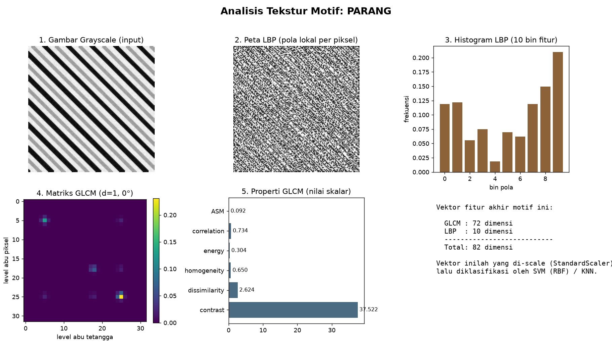
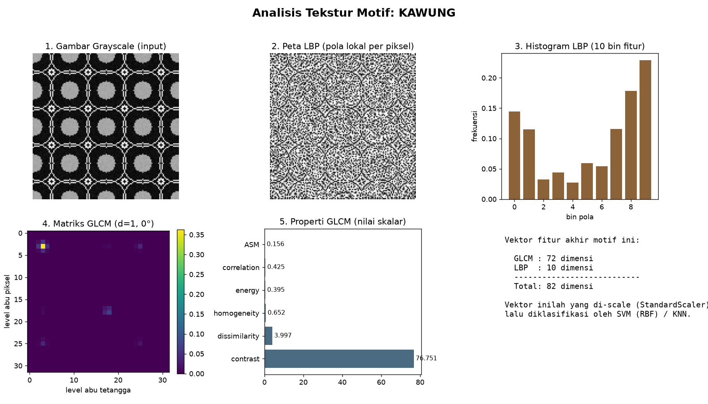
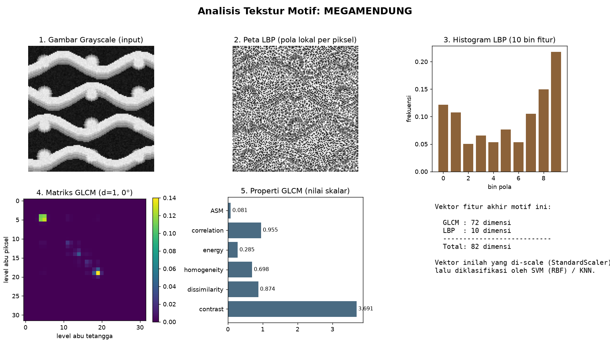

# GLCM + LBP + SVM — Cara Kerja pada Tiap Motif Batik

Dokumen ini menjelaskan pipeline **klasifikasi tekstur tradisional** (menu `[2]` di `main.py`)
dan menunjukkan hasilnya langsung pada tiap motif: **Parang, Kawung, Megamendung**.

Alur singkat untuk setiap gambar:

```
Gambar RGB → Grayscale → [ GLCM (72 fitur) + LBP (10 fitur) ] → 82 fitur
           → StandardScaler → SVM (RBF) / KNN → Motif terprediksi
```

Regenerate visual: `python docs/generate_visuals.py` (output di `docs/img/`).

---

## 1. GLCM — Gray-Level Co-occurrence Matrix

**Ide:** menghitung seberapa sering **pasangan piksel** dengan tingkat keabuan tertentu muncul
bersebelahan. Dari matriks ini diambil 6 properti statistik.

Kode: [`src/glcm_svm.py`](../src/glcm_svm.py) → `extract_glcm_features()`
- Gambar dikuantisasi ke **32 level abu** (`img/8`) biar matriks ringkas.
- Dihitung untuk **3 jarak** `[1, 2, 4]` × **4 sudut** `[0°, 45°, 90°, 135°]`.
- 6 properti: `contrast, dissimilarity, homogeneity, energy, correlation, ASM`.
- Total = **6 × 3 × 4 = 72 fitur**.

Properti kunci:
| Properti | Arti | Tinggi berarti |
| --- | --- | --- |
| contrast | beda keabuan antar tetangga | tekstur kasar/ramai |
| homogeneity | kemiripan piksel bersebelahan | tekstur halus/rata |
| correlation | keterhubungan pola linear | ada arah/garis teratur |
| energy / ASM | keseragaman pola | pola berulang konsisten |

## 2. LBP — Local Binary Pattern

**Ide:** untuk tiap piksel, bandingkan dengan 8 tetangganya (radius 1). Tetangga lebih terang → `1`,
lebih gelap → `0`. Hasilnya kode biner per piksel; distribusinya dirangkum jadi histogram.

Kode: [`src/lbp_extractor.py`](../src/lbp_extractor.py) → `extract_lbp_features()`
- `P=8, R=1, method='uniform'` → menghasilkan **10 bin** histogram = **10 fitur**.
- LBP menangkap **mikro-tekstur** (tepi, sudut, titik) dan tahan terhadap perubahan pencahayaan.

## 3. SVM — Support Vector Machine (Classifier)

Kalau GLCM & LBP tugasnya **mengubah gambar jadi 82 angka**, SVM tugasnya
**memutuskan 82 angka itu masuk motif yang mana**. Jadi SVM tidak "melihat gambar" —
dia bekerja di ruang 82 dimensi berisi fitur tekstur.

Kode: [`src/glcm_svm.py`](../src/glcm_svm.py) → `train_and_evaluate()` & `predict_single()`.

### Cara kerja
1. **Scaling dulu.** 82 fitur punya skala beda-beda (contrast bisa 76, energy cuma 0.3).
   `StandardScaler` menyeragamkan tiap fitur ke mean 0 / std 1 — wajib, karena SVM sensitif skala.
2. **Cari batas terluas (max-margin).** SVM menarik "garis" pemisah antar motif yang jaraknya
   **sejauh mungkin** dari titik-titik terdekat tiap kelas. Titik terdekat itu disebut
   **support vector** — hanya titik-titik ini yang menentukan batas, sisanya diabaikan.
3. **Kernel RBF untuk pola non-linear.** Motif tidak bisa dipisah garis lurus, jadi dipakai
   `kernel='rbf'` yang memetakan fitur ke dimensi lebih tinggi supaya bisa dipisah.

### Parameter yang dipakai
| Parameter | Nilai | Fungsi |
| --- | --- | --- |
| `kernel` | `'rbf'` | batas keputusan melengkung (non-linear) |
| `C` | `10.0` | seberapa keras menghindari salah klasifikasi (besar = margin ketat) |
| `gamma` | `'scale'` | jangkauan pengaruh tiap support vector |
| `probability` | `True` | supaya `predict_proba` bisa keluarkan confidence % |

### 3 kelas → strategi one-vs-one
SVM aslinya biner (2 kelas). Untuk 3 motif, scikit-learn otomatis melatih **3 SVM biner**
(Parang-vs-Kawung, Parang-vs-Megamendung, Kawung-vs-Megamendung), lalu voting mayoritas.

### KNN sebagai pembanding
`KNeighborsClassifier(k=5)` dilatih di fitur yang sama — untuk membuktikan bahwa fitur GLCM+LBP
memang bisa dipisah bahkan oleh algoritma sesederhana "lihat 5 tetangga terdekat".

### Peran SVM di benchmark (menu `[5]`)
Di pipeline "GLCM + LBP + SVM", **SVM adalah bagian tercepat**. Latency ~2.3 ms per gambar
hampir seluruhnya dipakai untuk **ekstraksi fitur GLCM+LBP** ([`src/benchmark.py:28-41`](../src/benchmark.py#L28-L41)).
`svm.predict()` di 82 fitur cuma **mikrodetik** — sekali perkalian kernel terhadap support vector.
Itu sebabnya metode tradisional ini jauh lebih ringan daripada CNN/CLIP: tidak ada jutaan bobot,
hanya beberapa support vector.

Model tersimpan di `models/` (`svm_model.pkl`, `knn_model.pkl`, `scaler.pkl`) — dimuat ulang saat
prediksi tanpa perlu latih ulang.

---

## Hasil per Motif

Angka di bawah adalah properti GLCM nyata (jarak=1, sudut=0°) dari sampel `data/test/`.
Justru **perbedaan angka inilah** yang membuat SVM bisa memisahkan ketiga motif.

| Properti (d=1, 0°) | Parang | Kawung | Megamendung |
| --- | --: | --: | --: |
| contrast | 37.52 | **76.75** | **3.69** |
| dissimilarity | 2.62 | 3.99 | 0.87 |
| homogeneity | 0.650 | 0.652 | **0.698** |
| energy | 0.304 | **0.395** | 0.285 |
| correlation | 0.734 | 0.425 | **0.955** |
| ASM | 0.092 | 0.156 | 0.081 |

### Parang — `docs/img/analysis_parang.png`


Garis diagonal miring yang berulang. **Contrast sedang (37.5)** dan **correlation cukup tinggi (0.73)**
mencerminkan garis-garis teratur searah. Pada matriks GLCM titik-titik energi tersebar di sepanjang
diagonal — ciri pola bergaris. Histogram LBP menonjol di bin tepi (garis miring = banyak transisi arah).

### Kawung — `docs/img/analysis_kawung.png`


Lingkaran/elips yang saling mengunci. **Contrast tertinggi (76.75)** dan **correlation terendah (0.43)**
karena banyak tepi melengkung ke segala arah — teksturnya paling "ramai". Energy/ASM tertinggi
menunjukkan pola berulang yang rapat.

### Megamendung — `docs/img/analysis_megamendung.png`


Gradasi awan yang halus dan bertingkat. **Contrast paling rendah (3.69)**, **homogeneity (0.70)** dan
**correlation (0.955) tertinggi** — piksel bersebelahan mirip, transisi lembut. Ini motif yang paling
mudah dibedakan secara tekstur karena karakternya berlawanan dengan Kawung.

---

**Kesimpulan:** GLCM menangkap *statistik pasangan piksel* (kasar/halus, berarah/tidak), LBP menangkap
*mikro-pola lokal*. Digabung jadi 82 fitur, ketiga motif punya sidik jari angka yang berbeda jelas,
sehingga SVM dapat mengklasifikasi dengan akurasi tinggi tanpa deep learning.

> Catatan: dataset ini **sintetis** (dibuat `src/generator.py`), jadi teksturnya bersih dan
> pemisahannya lebih mudah daripada foto batik asli.
